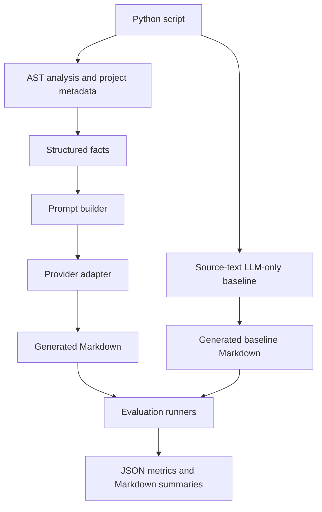

# LLM-Powered README Generator

Generates documentation from Python scripts using AST-based code analysis and large language models.

Developed for **CSE 5095**, this academic project explores a practical question: how can facts extracted from Python code help an LLM produce useful README documentation? It includes a command-line generator and separate evaluation workflows for AST-grounded and LLM-only generation.

## What it does

- Extracts imports, argparse options, docstrings, top-level definitions, environment-variable references, and nearby project metadata.
- Builds a structured prompt from those facts and generates a README through an LLM provider.
- Processes a single Python file or the immediate Python files in a directory.
- Supports OpenAI, Google Gemini, and Groq through a shared provider interface.
- Includes saved generated documents, evaluation summaries, and a project report.

This is a script-level documentation tool, not a whole-repository understanding system. Generated documentation requires human review.

## Explore without API access

| Resource | What to inspect |
|---|---|
| [Example Python script](Sample_scripts/QR_Generator.py) | An input from the sample collection |
| [Saved generated README](artifacts/readmegenv2_eval/ast-openai-openai/generated/QR_Generator_AI_README.md) | An example output from a recorded evaluation |
| [AST-grounded evaluation summary](artifacts/readmegenv2_eval/ast-openai-openai/summary_ast-openai-openai.md) | Aggregate metrics, per-file results, and error reporting |
| [LLM-only evaluation summary](artifacts/readmegenv2_eval_no_ast/no-ast-openai-openai/summary_no-ast-openai-openai.md) | A baseline run to inspect alongside the AST workflow |
| [Final project report](README_Generator_Final_Report.pdf) | Additional academic project context |

The sample scripts are evaluation inputs; their presence does not establish authorship of those programs.

## Architecture

The CLI always uses the analysis-based generation pipeline. The LLM-only baseline lives in a separate evaluation runner.



| Component | Responsibility |
|---|---|
| [CLI](readmegenv2/__main__.py) | Parses file/folder inputs and generation options |
| [Analysis](readmegenv2/analysis.py) | Parses Python syntax and discovers relevant project metadata |
| [Prompt builder](readmegenv2/prompt.py) | Converts extracted facts into generation messages |
| [Provider interface](readmegenv2/llm.py) | Selects and calls OpenAI, Gemini, or Groq |
| [Pipeline](readmegenv2/pipeline.py) | Coordinates analysis, generation, and file writing |
| [AST evaluation](tests/run_readmegenv2_eval.py) | Generates and evaluates AST-grounded READMEs |
| [LLM-only evaluation](tests/run_readmegenv2_no_ast_eval.py) | Generates and evaluates the no-AST baseline |

## Setup

Run the commands from the repository root. Use **Python 3.10 or newer** for the code's type-annotation syntax. The offline CI workflow targets Python 3.10, 3.11, and 3.12; it does not validate provider SDK compatibility or live API behavior.

```bash
git clone https://github.com/HIRAL13CHOKSI/-readme-gen-ai.git
cd ./-readme-gen-ai
python -m venv .venv
```

Activate the virtual environment:

- macOS/Linux: `source .venv/bin/activate`
- Windows PowerShell: `.venv\Scripts\Activate.ps1`

Then install the provider clients:

```bash
python -m pip install -r requirements.txt
python -m readmegenv2 --help
```

Dependencies currently use minimum versions rather than an exact environment lock. External service and SDK changes can affect reruns.

### Configure a provider

Set the corresponding environment variable in your local environment:

| CLI provider value | Environment variable | Client package |
|---|---|---|
| `openai` | `OPENAI_API_KEY` | `openai` |
| `google` | `GEMINI_API_KEY` or `GOOGLE_API_KEY` | `google-generativeai` |
| `groq` | `GROQ_API_KEY` | `groq` |

For example, in a POSIX shell:

```bash
export OPENAI_API_KEY="YOUR_LOCAL_API_KEY"
```

In PowerShell:

```powershell
$env:OPENAI_API_KEY = "YOUR_LOCAL_API_KEY"
```

Do not commit real keys. Prefer environment variables over command-line key overrides, which can appear in shell history or process listings.

**Provider note:** Gemini is selected with `--provider google`, although the current CLI help lists only `auto|openai|groq`. When `auto` is used, selection follows available keys in the order OpenAI → Google → Groq. Always pair an explicit provider with a model supported by that provider.

## Generate a README

### Single file

```bash
python -m readmegenv2 Sample_scripts/QR_Generator.py \
  --out README.generated.md \
  --provider openai \
  --model YOUR_AVAILABLE_OPENAI_MODEL \
  --print-facts
```

Replace the model placeholder with a model available to your account. This command writes a generated file without overwriting this repository's README.

### Folder of scripts

```bash
python -m readmegenv2 Sample_scripts \
  --out artifacts/generated_readmes \
  --provider openai \
  --model YOUR_AVAILABLE_OPENAI_MODEL
```

Folder mode processes immediate `.py` files in sorted order; it does not recurse. Each output is named `<script_stem>_AI_README.md`. Existing files at the chosen output paths can be overwritten.

For Gemini or Groq, use `--provider google` or `--provider groq` with the matching key and model.

### Optional help probing

Add `--probe-help` only for scripts you trust. It runs `python script.py --help` with a short timeout and inherits the current environment. A script can perform actions before handling `--help`; a timeout and temporary working directory do not provide a security sandbox.

Without this option, normal CLI generation analyzes the script rather than executing it. Analysis can also inspect nearby project metadata.

## Evaluation

Both runner sources pair files in `Sample_scripts/` with reference Markdown files of the same stem and define generated-document and report outputs. The AST runner's help command works without API access. The no-AST runner now uses a newly implemented source-text baseline; this is not a recovery of the original historical implementation.

| Signal | Interpretation |
|---|---|
| Dependency precision and recall | Dependency recovery under the runner's extraction and comparison rules |
| CLI completeness | Coverage of detected command-line arguments |
| Clarity, completeness, helpfulness | LLM-judge ratings on a 1–5 scale relative to reference documentation |
| Error records | Samples that could not be evaluated successfully |

These runners are experiments, not a conventional unit-test suite. They make paid external API calls. The AST runner performs help probing during evaluation, so run it only on trusted sample inputs in an appropriate environment. The new no-AST baseline accepts the evaluator's probe_help argument for compatibility but never executes the input script.

### Run an AST-grounded experiment

```bash
python tests/run_readmegenv2_eval.py \
  --gen-provider openai \
  --gen-model YOUR_AVAILABLE_OPENAI_MODEL \
  --judge-provider openai \
  --judge-model YOUR_AVAILABLE_OPENAI_MODEL \
  --run-label ast-openai-openai-new
```

Outputs: `artifacts/readmegenv2_eval/<run-label>/`.

### Run the new LLM-only baseline

The original no-AST implementation was absent from the repository. The replacement in `readmegenv2_no_ast/` sends script text to the selected LLM and requests structured JSON containing README Markdown, inferred third-party imports, and inferred CLI flags. It performs no AST analysis or input-script execution, validates the returned structure, and writes the Markdown only after validation succeeds.

**This is a new baseline (`source-text-baseline-v1`), not the implementation that produced historical artifacts.** Metadata is inferred by the LLM, not guaranteed ground truth. Use new run labels and record fresh results; no live quality benchmark has yet been run for this replacement.

```bash
python tests/run_readmegenv2_no_ast_eval.py \
  --gen-provider openai \
  --gen-model YOUR_AVAILABLE_OPENAI_MODEL \
  --judge-provider openai \
  --judge-model YOUR_AVAILABLE_OPENAI_MODEL \
  --run-label source-text-v1-openai-openai-new
```

Outputs: `artifacts/readmegenv2_eval_no_ast/<run-label>/`.

Generation and judging can use different providers. For example, use `--gen-provider google` with an available Gemini model and `--judge-provider openai` with an available OpenAI model. Configure both keys. Use new run labels to avoid mixing with recorded experiments.

### Recorded evidence and limitations

The committed [AST OpenAI→OpenAI summary](artifacts/readmegenv2_eval/ast-openai-openai/summary_ast-openai-openai.md) reports:

| Recorded measure | Value |
|---|---:|
| Evaluated samples | 20 |
| Samples skipped due to errors | 1 |
| Mean dependency precision | 1.000 |
| Mean dependency recall | 0.875 |
| Mean CLI completeness | 0.900 |
| Mean description clarity | 3.850 / 5 |
| Mean description completeness | 3.200 / 5 |
| Mean description helpfulness | 3.250 / 5 |

That run records `gpt-4o-mini` for both generation and judging. These figures describe a historical artifact, not a fresh reproduction or a guarantee on new scripts.

Interpret results with care:

- LLM judges introduce model-specific preferences; using the same model for generation and judging does not provide independent human validation.
- Reference documentation and extracted metadata are imperfect evaluation targets.
- The AST and no-AST runners use different metric implementations, including different empty-set dependency conventions. Their aggregate scores should not be treated as a controlled causal comparison without aligning the measurement rules.
- Errors, a small sample collection, and changing models or dependencies limit generalization and exact reproducibility.
- The records alone do not establish that AST grounding improves every metric or eliminates hallucinations.

## Data handling and practical limits

- Generation sends extracted code-derived facts to the selected external provider; judging sends generated/reference material. The new no-AST baseline sends the full input script text to the selected provider. Only process source code you are authorized to share.
- Inspect the inputs and provider terms before processing private code. Do not use secrets or confidential datasets as sample inputs.
- API access, quotas, network connectivity, and valid model identifiers are required for live generation and judging.
- Static analysis may miss dynamic imports, custom argument parsing, runtime behavior, or application context.
- Generated instructions, dependencies, badges, and other claims require review before publication.
- Offline baseline checks run in GitHub Actions; no supported deployment service is currently defined.

## Offline baseline checks

The [Offline checks workflow](.github/workflows/offline-checks.yml) runs on pull requests, pushes to `main`, and manual dispatch. It targets Python 3.10, 3.11, and 3.12, runs the existing mocked baseline tests, and checks the CLI and both evaluator help commands. It uses only the Python standard library: no dependency installation, provider credentials, generation runs, or paid API requests are needed. The workflow has read-only repository permissions.

Run the same checks locally from the repository root (a clean virtual environment is sufficient):

```bash
python -m unittest discover -s tests -p test_no_ast_pipeline.py -v
python -m readmegenv2 --help
python tests/run_readmegenv2_eval.py --help
python tests/run_readmegenv2_no_ast_eval.py --help
```

The tests mock provider calls; no API keys or paid requests are required. They cover provider routing, structured-response validation, output writing, error propagation, and non-execution of input scripts. Successful offline tests establish interface behavior, not LLM output quality.

## Repository guide

| Path | Contents |
|---|---|
| `readmegenv2/` | AST-grounded generator implementation |
| `readmegenv2_no_ast/` | New source-text baseline implementation |
| `Sample_scripts/` | Sample Python programs and reference Markdown |
| `Sample_Outputs/` | Additional saved generation examples |
| `tests/` | Evaluation runners and offline baseline tests |
| `artifacts/` | Recorded generation outputs, metrics, and summaries |
| `ast-gemini-gemini/` | Separately stored Gemini→Gemini experiment artifacts |
| `README_Generator_Final_Report.pdf` | Project report |

## Project context and next steps

This repository presents an academic CSE 5095 project. It does not establish that all sample programs were authored as part of the generator; sample provenance and any upstream attribution should be documented before reusing or redistributing them.

Potential next steps include offline tests for the AST analysis, consistent evaluation metrics across both runners, fresh baseline measurements, a recorded tested environment, and clearer sample provenance. These are proposed improvements, not implemented features.
